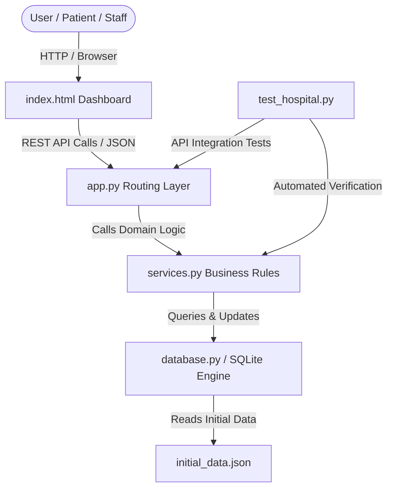

# AarogyaCare - Hospital Appointment Booking System
## Comprehensive Technical Project Report & Code Walkthrough

---

## 1. Executive Summary

**AarogyaCare** is an enterprise-grade Hospital Appointment Booking and Schedule Management System built with **Python Flask**, **SQLite**, **pytest**, and **flake8**. 

The system provides patients with the ability to search doctors across specializations, select appointment slots via an interactive calendar, manually enter personal details (Name, Age, Address, Phone Number), and manage scheduled bookings. It strictly prevents double booking, enforces active appointment limits, blocks retroactive/past bookings, and automatically computes tiered refunds in Indian Rupees (₹ INR) upon cancellation.

---

## 2. Technology Stack & Design System

| Layer | Technology | Details |
| :--- | :--- | :--- |
| **Backend Framework** | Flask 3.1.3 | Lightweight WSGI web framework, REST API endpoints |
| **Database** | SQLite3 | Embedded ACID-compliant relational database |
| **Testing Suite** | pytest 9.1.1 | Unit, boundary, and end-to-end integration testing (17/17 passed) |
| **Code Standard** | flake8 7.4.1 | Strict PEP 8 linting and style checking (0 warnings/errors) |
| **Frontend / UI** | HTML5, Vanilla CSS, Vanilla JS | Monochrome Black/Grey/White gradient UI with custom scrollbars |
| **Date & Time Picker** | Flatpickr | Dark-themed interactive calendar & 24hr time dropdown menu |
| **Currency** | Indian Rupee (`₹ INR`) | Formatted with Indian locale comma separation (`en-IN`) |

---

## 3. System Architecture & Project Structure

```
SE Practical/
├── initial_data.json     # 50 Indian doctors and 50 Indian patients initial dataset
├── database.py           # SQLite connection, schema definition & seeding engine
├── services.py           # Core domain logic (booking, refund, limits, past validation)
├── app.py                # Flask application, REST API routing, JSON serialization
├── test_hospital.py      # Automated pytest suite covering 17 business scenarios
├── hospital.db           # SQLite database file (generated automatically)
└── templates/
    └── index.html        # Single-Page Application (SPA) responsive dashboard
```



---

## 4. Database Schema Design ([`database.py`](file:///c:/Users/MILIND%20SAHU/OneDrive/Documents/SE%20Practical/database.py))

The database schema utilizes three relational tables:

### 1. `doctors` Table
Stores doctor profile information and consultation charges.
- `id` (INTEGER, PRIMARY KEY AUTOINCREMENT)
- `name` (TEXT NOT NULL) — e.g. "Dr. Rajesh Sharma"
- `specialization` (TEXT NOT NULL) — e.g. "Cardiology", "Neurology"
- `consultation_fee` (REAL NOT NULL DEFAULT 500.0) — e.g. ₹800.00

### 2. `patients` Table
Supports dynamic manual patient registration.
- `id` (INTEGER, PRIMARY KEY AUTOINCREMENT)
- `name` (TEXT NOT NULL)
- `phone` (TEXT NOT NULL, indexed for lookup and active tracking)
- `age` (INTEGER)
- `address` (TEXT)
- `email` (TEXT)

### 3. `appointments` Table
Tracks bookings, execution status, and refund transactions.
- `id` (INTEGER, PRIMARY KEY AUTOINCREMENT)
- `doctor_id` (INTEGER NOT NULL, FK -> doctors.id)
- `patient_id` (INTEGER NOT NULL, FK -> patients.id)
- `slot_time` (TEXT NOT NULL) — Stored as `YYYY-MM-DD HH:MM:SS`
- `fee` (REAL NOT NULL) — Snapshot of doctor fee at time of booking
- `status` (TEXT CHECK status IN ('ACTIVE', 'CANCELLED'))
- `refund_amount` (REAL DEFAULT 0.0)
- `refund_percentage` (REAL DEFAULT 0.0)
- `created_at` (TEXT NOT NULL)

---

## 5. Core Business Logic & Algorithms ([`services.py`](file:///c:/Users/MILIND%20SAHU/OneDrive/Documents/SE%20Practical/services.py))

### 1. Double Booking Prevention
A doctor cannot have more than one active appointment at any given date and time slot:
```python
cursor.execute(
    "SELECT id FROM appointments "
    "WHERE doctor_id = ? AND slot_time = ? AND status = 'ACTIVE'",
    (doctor_id, formatted_slot)
)
if cursor.fetchone():
    return {
        "success": False,
        "error": "Double booking error: Doctor already has an active appointment at this slot.",
        "status_code": 409
    }
```
*Note: If an appointment is cancelled, the slot becomes active and available for re-booking.*

### 2. Cancellation & Tiered Refund Policy
Refunds are calculated based on the difference between the cancellation timestamp and the scheduled slot timestamp:

$$\text{Hours Ahead} = \frac{\text{Slot Time} - \text{Cancellation Time}}{3600}$$

$$\text{Refund \%} = \begin{cases} 
100\% & \text{if Hours Ahead } > 24 \\ 
50\% & \text{if } 0 \le \text{Hours Ahead } \le 24 \\ 
0\% & \text{if Hours Ahead } < 0 
\end{cases}$$

$$\text{Refund Amount} = \text{Fee} \times \left(\frac{\text{Refund \%}}{100}\right)$$

### 3. Retroactive Date Validation
Rejects appointments scheduled for any historical time:
```python
if slot_time <= current_time:
    return {
        "success": False,
        "error": "Cannot book appointment in the past.",
        "status_code": 400
    }
```

### 4. Active Appointment Limit
To prevent appointment hoarding, each patient is capped at **2 active appointments**:
```python
cursor.execute(
    "SELECT COUNT(*) AS count FROM appointments "
    "WHERE patient_id = ? AND status = 'ACTIVE'",
    (patient_id,)
)
if cursor.fetchone()["count"] >= 2:
    return {
        "success": False,
        "error": "Patient limit reached: Maximum 2 active appointments allowed.",
        "status_code": 400
    }
```

### 5. Doctor Search Algorithm
Performs case-insensitive substring matching against both doctor names and specializations:
```python
term = f"%{query.strip()}%"
cursor.execute(
    "SELECT id, name, specialization, consultation_fee FROM doctors "
    "WHERE LOWER(name) LIKE LOWER(?) OR LOWER(specialization) LIKE LOWER(?) "
    "ORDER BY name ASC",
    (term, term)
)
```

---

## 6. REST API Endpoints ([`app.py`](file:///c:/Users/MILIND%20SAHU/OneDrive/Documents/SE%20Practical/app.py))

| Endpoint | Method | Payload / Params | Response | Description |
| :--- | :---: | :--- | :--- | :--- |
| `/` | `GET` | None | HTML | Renders web dashboard |
| `/api/doctors` | `GET` | `?q=<term>` | `JSON Array` | Filter doctors by name or specialization |
| `/api/patients` | `GET` | None | `JSON Array` | Fetches registered patient profiles |
| `/api/appointments` | `GET` | None | `JSON Array` | Retrieves all appointments with doctor/patient joins |
| `/api/appointments` | `POST` | `patient_name, patient_phone, patient_age, patient_address, doctor_id, slot_time` | `201 Created` / `400` / `409` | Books appointment with validation checks |
| `/api/appointments/<id>/cancel` | `POST` | None | `200 OK` / `400` / `404` | Cancels appointment and calculates ₹ refund |

---

## 7. Frontend User Interface ([`templates/index.html`](file:///c:/Users/MILIND%20SAHU/OneDrive/Documents/SE%20Practical/templates/index.html))

The user interface is engineered with a **Black, Grey, and White Monochrome Gradient Theme**:
1. **Header Banner**: Live currency badges (`₹ INR`), patient active caps, and refund formulas.
2. **Full-Scale Doctor Directory**:
   - Expansive table listing all 50 doctors with real-time counter badges.
   - Instant search bar with debounced filtering.
   - **"Select for Booking"** button to auto-select any doctor in the scheduler.
3. **Schedule Appointment Panel**:
   - Patient manual input cards (Name, Phone, Age, Address/City).
   - Flatpickr dark-mode calendar dropdown with 15-minute time intervals.
   - Embedded **System Safeguards Panel** providing immediate visibility into system constraints.
4. **Appointments Ledger**:
   - Chronological table showing patient details, assigned doctor, consultation fee in `₹`, and status badges.
   - Interactive cancellation trigger with instant refund alert receipts.
5. **Custom Scrollbars**: Modern slim monochrome scrollbars with glowing hover states.

---

## 8. Automated Test Suite ([`test_hospital.py`](file:///c:/Users/MILIND%20SAHU/OneDrive/Documents/SE%20Practical/test_hospital.py))

The test suite runs with isolated SQLite temporary databases to ensure complete test determinism:

```
============================= test session starts =============================
platform win32 -- Python 3.12.3, pytest-9.1.1, pluggy-1.7.0
rootdir: C:\Users\MILIND SAHU\OneDrive\Documents\SE Practical
collected 17 items

test_hospital.py::test_search_doctors_by_specialization PASSED           [  5%]
test_hospital.py::test_search_doctors_by_name PASSED                     [ 11%]
test_hospital.py::test_search_doctors_case_insensitive_and_partial PASSED [ 17%]
test_hospital.py::test_search_doctors_empty_query_returns_all PASSED     [ 23%]
test_hospital.py::test_search_doctors_api_endpoint PASSED                [ 29%]
test_hospital.py::test_book_appointment_in_past_rejected PASSED          [ 35%]
test_hospital.py::test_book_appointment_invalid_date_format PASSED       [ 41%]
test_hospital.py::test_prevent_double_booking_same_doctor_and_slot PASSED [ 47%]
test_hospital.py::test_different_doctors_same_slot_allowed PASSED        [ 52%]
test_hospital.py::test_same_slot_bookable_after_cancellation PASSED      [ 58%]
test_hospital.py::test_patient_active_appointment_limit PASSED           [ 64%]
test_hospital.py::test_patient_can_book_after_cancelling_one PASSED      [ 70%]
test_hospital.py::test_refund_more_than_24_hours_ahead PASSED            [ 76%]
test_hospital.py::test_refund_within_24_hours_ahead PASSED               [ 82%]
test_hospital.py::test_refund_exactly_24_hours_ahead PASSED              [ 88%]
test_hospital.py::test_cancellation_flow_end_to_end PASSED               [ 94%]
test_hospital.py::test_api_booking_and_cancellation PASSED               [100%]

============================= 17 passed in 2.53s ==============================
```

- **Style Validation**: Verified via `python -m flake8 .` (0 errors, 0 warnings).
- **Execution Command**: `python app.py` on `http://127.0.0.1:5000`.
